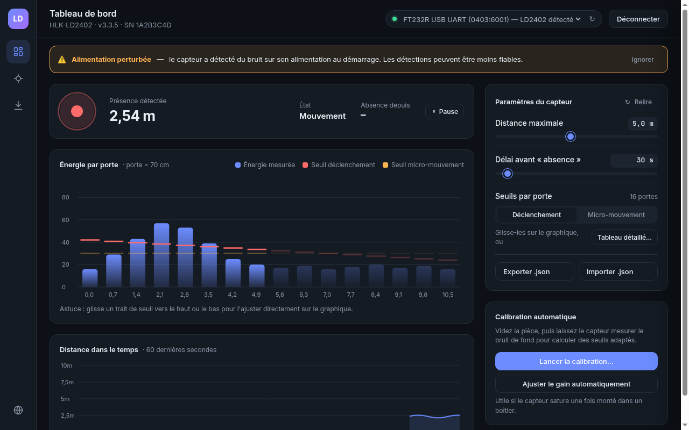

# LD2402 Studio

[English](README.md)

Une application de bureau pour configurer, calibrer et surveiller le capteur radar millimétrique 24 GHz **HLK-LD2402** via un adaptateur USB-série. Construite avec Tauri 2 (cœur Rust, interface TypeScript). Fonctionne sous Windows, macOS et Linux.



## Fonctions

- Tableau de bord en direct : présence, distance, et énergie des 16 portes de distance face à leurs seuils.
- Glisser les seuils de déclenchement et de micro-mouvement directement sur le graphique.
- Calibration en un clic (coefficients réglables) et ajustement automatique du gain.
- Lecture et écriture de tous les paramètres du capteur (distance max, délai de disparition, seuils par porte).
- Export et import de la configuration en fichier JSON.
- Interface en français et en anglais ; d'autres langues s'ajoutent facilement (voir [CONTRIBUTING.md](CONTRIBUTING.md)).
- Simulateur de capteur intégré pour tout essayer sans matériel.

La mise à jour du firmware n'est pas disponible : le protocole n'est pas public (voir [docs/firmware-update-research.md](docs/firmware-update-research.md)).

## Téléchargement et installation

Récupérez l'installeur pour votre système sur la page [Releases](../../releases) : `.msi` / `.exe` (Windows), `.dmg` (macOS), `.deb` / `.AppImage` (Linux).

Les versions ne sont **pas signées** : votre système affichera un avertissement la première fois.

- **macOS** : clic droit sur l'application, **Ouvrir**, puis confirmer. Si macOS refuse encore, lancez `xattr -dr com.apple.quarantine "/Applications/LD2402 Studio.app"`.
- **Windows** : dans la fenêtre SmartScreen, cliquez sur **Informations complémentaires**, puis **Exécuter quand même**.
- **Linux** : `sudo apt install ./*.deb`, ou `chmod +x *.AppImage` puis lancez-le.

### Droits d'accès au port série (Linux)

Pour ouvrir le port série, vous devez être dans le groupe `dialout` :

```sh
sudo usermod -aG dialout $USER
```

Puis fermez la session et rouvrez-la.

## Câblage

Liaison série : 115200 bauds, 8N1. Reliez le capteur à un adaptateur USB-série 3,3 V (manuel, tableau 4-1) :

| Capteur | Adaptateur |
|---------|------------|
| RX      | TXD        |
| TX      | RXD        |
| GND     | GND        |
| 3V3     | VCCIO (3,3 V) |

N'utilisez pas de niveaux logiques 5 V.

## Conseils d'utilisation

- Choisissez le port puis cliquez sur **Connecter**. Le capteur passe en mode ingénieur pour la vue en direct, et est toujours remis en mode normal à la déconnexion ou à la fermeture.
- Les modifications sont des **brouillons** : rien n'est envoyé au capteur tant que vous n'appuyez pas sur **Écrire**. Avec un firmware 3.3.2 ou plus récent, l'écriture sauvegarde aussi les valeurs de façon permanente ; sur un firmware plus ancien, elles durent jusqu'à la prochaine coupure d'alimentation.
- Faites glisser la poignée d'un seuil sur le graphique pour le changer ; cela reste un brouillon jusqu'à l'écriture.
- Coefficients de calibration : plus le coefficient est élevé, plus le capteur est sensible (1,0 à 20,0).
- L'import nécessite un capteur connecté.

## Fichier de configuration

Les fichiers exportés ressemblent à ceci (distance arrondie à 0,1 m, dB à 0,01) :

```json
{
  "format": "ld2402-studio-config",
  "version": 1,
  "firmware": "v3.3.1",
  "savedAt": "2026-11-05T10:00:00Z",
  "params": {
    "maxDistanceM": 6.0,
    "disappearDelayS": 5,
    "triggerDb": [40.0, 40.0, 38.5, 36.0, 34.0, 32.0, 30.0, 30.0, 28.0, 28.0, 26.0, 26.0, 24.0, 24.0, 22.0, 22.0],
    "microDb": [32.0, 32.0, 30.5, 28.0, 26.0, 24.0, 22.0, 22.0, 20.0, 20.0, 18.0, 18.0, 16.0, 16.0, 14.0, 14.0]
  }
}
```

Chaque tableau contient 16 nombres, un par porte. L'import vérifie les plages : distance de 0,7 à 10 m, délai de 0 à 65535 s, seuils de 0 à 95 dB.

## Simulateur

Dans les versions de débogage, ou avec `LD2402_SIM=1`, un port **Simulator** apparaît dans la liste des ports.

```sh
LD2402_SIM=1 ./ld2402-studio
LD2402_SIM_VERSION=v3.3.1 LD2402_SIM=1 ...   # se faire passer pour un autre firmware
LD2402_SIM_FAIL_AFTER=50 LD2402_SIM=1 ...    # coupe la liaison après 50 lectures
```

## Compiler depuis les sources

Prérequis : Node 22, Rust (stable) et, sous Linux, `libwebkit2gtk-4.1-dev libudev-dev librsvg2-dev libayatana-appindicator3-dev build-essential`.

```sh
npm ci
npm run tauri dev     # développement
npm run tauri build   # installeurs dans src-tauri/target/release/bundle/
```

## Licence

MIT, voir [LICENSE](LICENSE).
