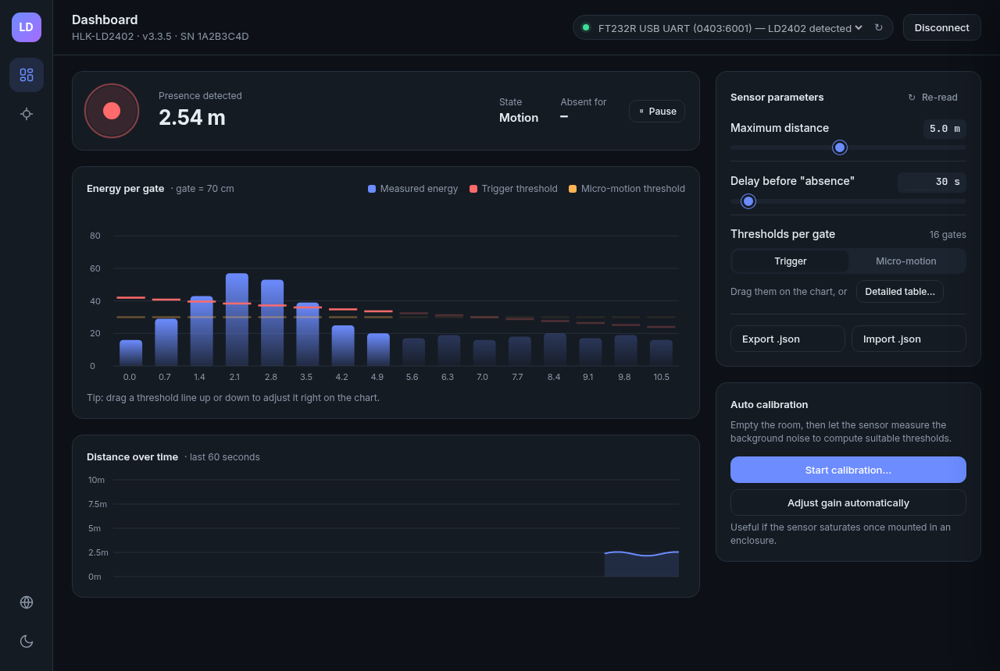

# LD2402 Studio

[Français](README.fr.md)

A desktop app to configure, calibrate and monitor the **HLK-LD2402** 24 GHz mmWave radar sensor over a USB-serial adapter. Built with Tauri 2 (Rust core, TypeScript front-end). Works on Windows, macOS and Linux.



## Features

- Live dashboard: presence, distance, and the energy of the 16 range gates against their thresholds.
- Drag the trigger and micro-motion thresholds directly on the chart.
- One-click calibration (with adjustable coefficients) and automatic gain adjustment.
- Read and write all sensor parameters (max distance, disappear delay, per-gate thresholds).
- Export and import the configuration as a JSON file.
- English and French interface; more languages are easy to add (see [CONTRIBUTING.md](CONTRIBUTING.md)).
- Built-in sensor simulator, so you can try everything without hardware.

Firmware update is not available: the update protocol is not public (see [docs/firmware-update-research.md](docs/firmware-update-research.md)).

## Download and install

Get the installer for your system from the [Releases](../../releases) page: `.msi` / `.exe` (Windows), `.dmg` (macOS), `.deb` / `.AppImage` (Linux).

The builds are **not code-signed**, so your OS will warn you the first time:

- **macOS**: right-click the app, choose **Open**, then confirm. If macOS still refuses, run `xattr -dr com.apple.quarantine "/Applications/LD2402 Studio.app"`.
- **Windows**: in the SmartScreen window click **More info**, then **Run anyway**.
- **Linux**: `sudo apt install ./*.deb`, or `chmod +x *.AppImage` and run it.

### Linux serial permissions

To open the serial port you must be in the `dialout` group:

```sh
sudo usermod -aG dialout $USER
```

Then log out and back in.

## Wiring

Serial settings: 115200 baud, 8N1. Connect the sensor to a 3.3 V USB-serial adapter (manual, Table 4-1):

| Sensor | Adapter |
|--------|---------|
| RX     | TXD     |
| TX     | RXD     |
| GND    | GND     |
| 3V3    | VCCIO (3.3 V) |

Do not use 5 V logic levels.

## Usage tips

- Pick the port, click **Connect**. The sensor is put in engineering mode for the live view, and always put back in normal mode when you disconnect or quit.
- Edits are **drafts**: nothing is sent to the sensor until you press **Write**. On firmware 3.3.2 and later, Write also saves the values permanently; on older firmware, whether they survive a power cycle is still to be verified on hardware.
- Drag a threshold handle on the chart to change it; the value is still a draft until written.
- Calibration coefficients: a higher coefficient makes the sensor more sensitive (1.0 to 20.0).
- Import requires a connected sensor.

## Configuration file

Exported files look like this (distance rounded to 0.1 m, dB to 0.01):

```json
{
  "format": "ld2402-studio-config",
  "version": 1,
  "firmware": "v3.3.1",
  "savedAt": "2026-11-05T10:00:00Z",
  "params": {
    "maxDistanceM": 6.0,
    "disappearDelayS": 5,
    "triggerDb": [40.0, 40.0, 38.5, 36.0, 34.0, 32.0, 30.0, 30.0, 28.0, 28.0, 26.0, 26.0, 24.0, 24.0, 22.0, 22.0],
    "microDb": [32.0, 32.0, 30.5, 28.0, 26.0, 24.0, 22.0, 22.0, 20.0, 20.0, 18.0, 18.0, 16.0, 16.0, 14.0, 14.0]
  }
}
```

Each array holds 16 numbers, one per gate. Import checks the ranges: distance 0.7 to 10 m, delay 0 to 65535 s, thresholds 0 to 95 dB.

## Simulator

In debug builds, or when `LD2402_SIM=1` is set, a **Simulator** port appears in the port list.

```sh
LD2402_SIM=1 ./ld2402-studio
LD2402_SIM_VERSION=v3.3.1 LD2402_SIM=1 ...   # pretend to be another firmware
LD2402_SIM_FAIL_AFTER=50 LD2402_SIM=1 ...    # drop the link after 50 reads
```

## Build from source

Requirements: Node 22, Rust (stable), and on Linux `libwebkit2gtk-4.1-dev libudev-dev librsvg2-dev libayatana-appindicator3-dev build-essential`.

```sh
npm ci
npm run tauri dev     # development
npm run tauri build   # installers in src-tauri/target/release/bundle/
```

## License

MIT, see [LICENSE](LICENSE).
